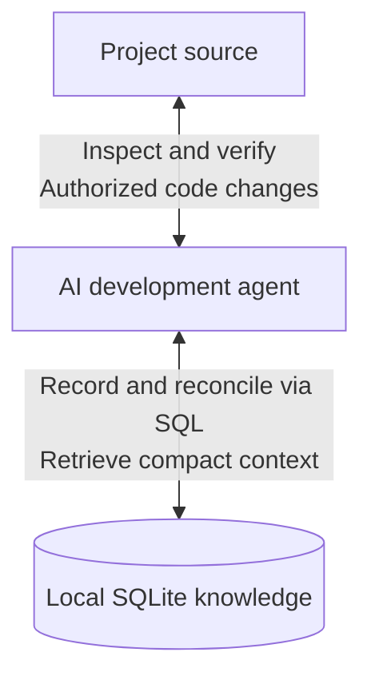

# EvoMneme

**Memory that evolves with the code.**

**An AI tool, built by AI, for AI.**

EvoMneme helps AI development agents retain useful project knowledge without flooding their working context. The agent maintains a local SQLite graph of code entities, relationships, findings, and decisions, then retrieves compact context and follows source locations when details matter. Technical, product, visual, and UI/UX reasons can survive beyond the conversation that discovered them.

## Why keep project memory?

New sessions and limited working context can leave an agent rediscovering project structure, dependencies, and the reasons behind earlier decisions. EvoMneme gives the agent a place to preserve useful findings and retrieve them later, while keeping the original source authoritative.

## An agent-maintained knowledge graph

The tool is deliberately thin: **receive SQL → execute it in SQLite → return a compact result**. The agent chooses and evolves the schema, writes SQL, checks source/version provenance, and reconciles knowledge during normal work. No domain-specific indexing API or automatic code analyzer stands between the agent and SQLite.



The agent drives this loop during active development sessions. SQLite stores knowledge; optional MCP carries SQL calls and results. Neither independently interprets code or maintains the graph.

## What is included

- [SKILL.md](SKILL.md): one live portable instruction set for authorized host projects, connected through their agent's native instruction mechanism.
- [scripts/evomneme.py](scripts/evomneme.py): an optional Python standard-library SQL executor with the shared `Executor.execute_sql` API, per-command parameters, explicit native transactions, and bounded column/row results.
- [scripts/evomneme_mcp.py](scripts/evomneme_mcp.py): an optional stdio MCP adapter exposing the same `execute_sql` operation, bound to one explicit database at startup. Agents can call it without constructing outer shell commands.
- [schema.sql](schema.sql): an optional raw SQLite starter script, never automatically applied or imposed on existing databases. Its multi-statement form requires a native script facility, rather than `--sql-file`.

**Each host project has its own local SQLite file. This repository is not its knowledge store.** Linked worktrees explicitly share one canonical host database; independent clones/projects use separate files. Keep knowledge and associated local state excluded from Git. Never activate EvoMneme in its own repository, forks, or worktrees; isolated development fixtures are allowed.

## Use it in a host project

Authorize your agent, for example:

> Connect EvoMneme from this trusted checkout to my project at `<host-project>`. Keep its database local and excluded from Git. Load the live instructions in every project session and verify fresh-session loading and instruction update/reload. Choose the schema and maintain useful knowledge during ordinary development. Use the SQL CLI or optional project-local MCP transport already supported by my environment.

Finding this README or a skill in a catalog does not grant integration permission. Once authorized, follow [connection and verification](references/integration.md), [SQL/storage practice](references/storage.md), and [optional MCP setup](references/mcp.md). A skill catalog entry, running MCP process, or written instruction pointer alone does not prove that every session loads the instructions. Unsupported activation or self-update verification remains an explicit incomplete setup.

These usage references are the public interface: they explain Python import/create/close, CLI/MCP startup, schema setup, and the [shared request/result/error contract and limits](references/mcp.md#shared-sql-contract). Agents need not inspect the scripts to use them.

The optional CLI uses an existing Python 3.11+ runtime and SQLite support; it installs no SDK or third-party package. With a previously selected, excluded host database and reviewed query file:

```text
python <tool>/scripts/evomneme.py --database <absolute-host-db> --input <host-local>/query.json
```

```json
{"sql":"SELECT id,title,summary FROM records WHERE scope_id=:scope AND validity='current' LIMIT 8","params":{"scope":"verified-scope-id"},"max_rows":8}
```

This query assumes the optional starter; the executor accepts agent-designed schemas too. Each SQL string is one native SQLite statement; use a `sql` array of `{sql,params}` commands for batches, with explicit `BEGIN`/`COMMIT` when atomicity is needed. Ordinary SELECTs return a bounded prefix and `has_more`, without scanning omitted rows just to count them. Creation is explicit with `--create`, which creates an empty file only. Inspect existing schemas before changes. Prefer configured host-bound MCP, then a direct Python call without shell wrapping, then CLI JSON input. Native SQLite remains appropriate when deliberately selected or Python is unavailable. This ranking does not authorize switching after a configured integration fails.

## Autonomy and limits

The agent consults knowledge when useful, records meaningful discoveries and decisions during exploration/coding/review/debugging, and updates stale claims and dependents as sources change. Subagents can handle substantial maintenance when supported and beneficial. Retrieval failures and repeated discovery should lead to measured schema/query/instruction improvements. Nothing runs continuously after the agent's sessions end.

The primary focus is software development across languages and frameworks; other project types may use the same mechanism. No external analyzer, service, agent framework, additional skill, or installed dependency beyond SQLite and its libraries is required. MCP is optional and does not load the skill by itself.

This is an evolving project, not a guarantee of complete code understanding, correct dependency detection, automatic source invalidation, or proven efficiency gains. SQL execution success proves neither a fact's truth nor a host's identity: the agent is responsible for schema integrity, version filters, source validation, and maintenance. Native SQLite transactions and bounded output support that work; a command batch is atomic only when it explicitly begins and commits a transaction. Actual every-session activation and self-update must be verified in each host environment. See [EVOLUTION.md](EVOLUTION.md) for observed results and design changes.

## Built by AI, open to improvement

Humans and AI agents are welcome to **fork → improve → pull request**. Review the [charter](PROJECT_CHARTER.md) and [contribution guide](CONTRIBUTING.md); keep improvements reusable and never publish host knowledge, private source, secrets, or unpublished decisions. Changing the charter requires explicit human approval. Released under the [MIT License](LICENSE).
